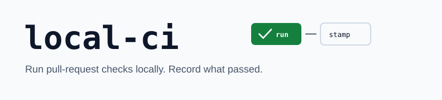
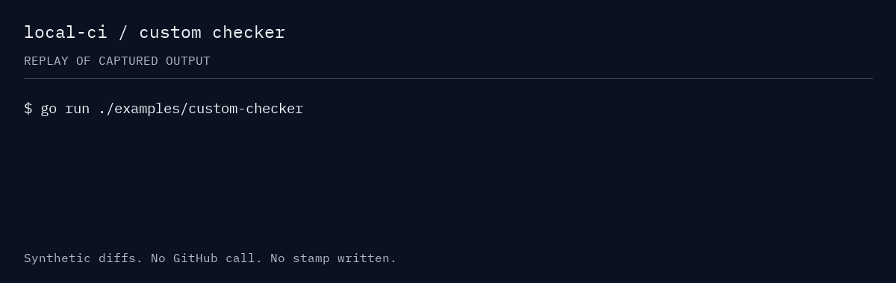

<picture>
  <source media="(prefers-color-scheme: dark)" srcset=".github/assets/banner-dark.svg">
  
</picture>



The demo replays captured output from the offline example; it does not run a GitHub PR or write a stamp.
[Static transcript](.github/assets/demo-transcript.md) · [Reproduce the demo](.github/assets/README.md)

[](LICENSE)


Run a pull request's checks on your machine before asking to merge. local-ci records their results
in a git note on the head commit, and its optional GitHub merge gate reads that record to avoid
repeating the checks it covers.

## Contents

- [What it does](#what-it-does) describes the checks local-ci runs, the stamp it writes, and the merge gate that reads it.
- [Quick start](#quick-start) runs an offline check and installs the two command-line tools.
- [Choosing an entry point](#choosing-an-entry-point) maps each task to the command or API that handles it.
- [Usage](#usage) gives a complete example for each entry point.
- [Reference](#reference) lists the flags, the built-in checkers, and the stamp format.
- [Before you rely on it](#before-you-rely-on-it) names the limits that are inherent or by design.
- [Project](#project) covers versioning, tests, and how to contribute.

## What it does

- **`local-ci --pr <N>`** runs the checks a pull request's diff triggers, then writes a git-notes
  stamp on the head commit recording which passed. A [merge gate](#the-github-action) reads the
  stamp and skips the checks already run locally.
- **Bring your own checks.** local-ci doesn't lock you to a fixed list — you hand it your own checks
  (any Go type that satisfies `checker.Checker`, wired in with `runner.NewRunner`) and it runs
  those. See [examples/custom-checker](examples/custom-checker/).
- **Nine built-in checkers** ship with the CLI — covering linked issues, review replies, proto
  `buf` gates, new-folder READMEs, and Go/pnpm vulnerability and lint scans. The
  [Built-in checkers](#built-in-checkers) table lists each.
- **`deps`** is a companion tool that lists the Go packages and directories a changed-file set
  impacts, for scoping a build or test run.
- **The GitHub Action merge gate** reads the stamp on a pull request and passes the checks it
  already covers without re-running them. See [the GitHub Action](#the-github-action).

### What it does not do

- It does not host or replace CI. It records what ran locally. A GitHub workflow still decides
  what to require.
- It does not run checks on a remote machine. Checks run on your machine, against your checkout.
- It does not discover checks from your repository. The checker set is the list a host program
  passes to `runner.NewRunner`.
- It is not a general task runner. Each check looks at one thing on a pull request and says pass or fail.

## Quick start

The offline examples need Go 1.25 or newer. Once Go dependencies are downloaded, they need no
GitHub account, credentials or network calls. The full `local-ci --pr` workflow additionally needs
Git, an authenticated [GitHub CLI](https://cli.github.com/), a real pull request, and the tools
used by the eligible checkers.

### Try a check offline

Clone the repository and run the [custom-checker example](examples/custom-checker/).
The example uses two synthetic diffs and calls the public `checker.Checker` interface
directly; it does not run the engine or write a stamp.

```sh
git clone https://github.com/tetriz-ai/local-ci.git
cd local-ci
go run ./examples/custom-checker
```

```text
clean diff: PASS
diff with a _wip.go file: FAIL — remove work-in-progress files before merge: pkg/service/scratch_wip.go
```

The checker accepts a normal Go file and identifies the work-in-progress file to remove before
merge. [All three examples](examples/README.md) also show how to assemble a checker set and read
the stamp format.

### Install the command-line tools

The [v0.1.0 release](https://github.com/tetriz-ai/local-ci/releases/tag/v0.1.0) provides six archives,
for macOS (`darwin`), Linux and Windows on `amd64` and `arm64`. Each contains both `local-ci` and
`deps`, the README, license, notices, third-party material and `SOURCE.json` provenance.
The binaries start without Go installed, but `deps impacteddirs` and `deps impactedpkgs` load
Go packages and require the Go toolchain. Individual `local-ci` checkers may also require Go or other tools.

For a Mac with Apple silicon, download and check the release:

```sh
mkdir -p /tmp/local-ci-v0.1.0
cd /tmp/local-ci-v0.1.0
curl -fLO https://github.com/tetriz-ai/local-ci/releases/download/v0.1.0/local-ci_0.1.0_darwin_arm64.tar.gz
curl -fLO https://github.com/tetriz-ai/local-ci/releases/download/v0.1.0/checksums.txt
shasum -a 256 --check --ignore-missing checksums.txt
tar -xzf local-ci_0.1.0_darwin_arm64.tar.gz
./local-ci --version
./deps --help
```

Choose the corresponding OS and architecture for your machine; Windows archives use `.zip`
and contain `.exe` binaries. Put both extracted binaries in a directory on your `PATH` to use
`local-ci` and `deps` from any checkout. Checksums detect a damaged download; they are not signatures.

With Go installed, you can also build the tools from the tagged module:

```sh
go install github.com/tetriz-ai/local-ci/cmd/local-ci@v0.1.0
go install github.com/tetriz-ai/local-ci/cmd/deps@v0.1.0
```

Go installs into `$(go env GOPATH)/bin`, which must be on your `PATH`.

### Run against a pull request

From the root of a repository with an open PR and `gh` authenticated:

```sh
local-ci --pr 1234
```

Replace `1234` with your PR number. A run can change your checkout, push a git note and update
GitHub; see [what local-ci changes](#what-local-ci-changes-on-your-repo-and-github) before using it.
The flags named `workflows` select checkers; `--dry-run` still needs a real PR and GitHub access.

## Choosing an entry point

| You have | Use | Example |
|---|---|---|
| Validate a pull request and stamp it | `local-ci --pr <N>` | [run local-ci](#local-ci---pr-n) |
| Gate merges on the local stamp | the GitHub Action | [the GitHub Action](#the-github-action) |
| Run your own check through the engine | `runner.NewRunner` | [custom-checker](examples/custom-checker/) |
| List the packages a change impacts | `deps impacteddirs` | [deps](#deps) |

The command-line workflows use the current checkout. The three library examples use synthetic
inputs and run offline; `local-ci --pr` and the Action require GitHub integration.

## Usage

### `local-ci --pr <N>`

When: you have an open pull request and want to run its checks locally and stamp the commit.

```sh
# from the repository root, with gh authenticated
local-ci --pr 1234
```

A green run stamps the head commit. If a check fails, it tells you what to fix and exits
non-zero. Pass `-e=<name>` to run a subset, or `-e=all` to select every eligible checker.
Use `--force` to discard reusable results and execute the selected checks again.

Remember:

- The stamp is tied to the commit SHA. A new commit after the stamp leaves the head unstamped, so
  run local-ci last, just before requesting merge.
- A check only runs when your change touches files it cares about, so a change that only touches
  backend files skips the frontend checks.

### The GitHub Action

The GitHub Action reads a stamp on a pull request's head commit and passes when it
records the required checks for the matching base branch. The [example merge gate](examples/local-ci-merge-gate.yml)
is a template for adopters; it is deliberately outside this repository's active workflows.

Replace the example's `REPLACE_WITH_TRUSTED_40_CHARACTER_COMMIT_SHA` with a reviewed, immutable
40-character commit SHA from the public repository before activating the workflow. Fetch the notes from the
base repository before running it. Use the `labeled` trigger too: local-ci re-applies the
`RunWorkflows` label after stamping so the gate re-runs once the stamp exists.

A required check alone does not protect its workflow definition. A `pull_request` workflow comes
from the PR's merge commit, so that PR can edit the workflow to bypass the gate. Protect
`.github/**` with CODEOWNERS and required owner review, or configure a ruleset-required workflow
from a trusted ref. Never run a local action from the PR checkout as the enforcement step.
See [the action](.github/actions/local-ci-checker/action.yml) and the trust model below.

### `deps`

When: you want the Go packages or directories a changed-file set impacts. `impacteddirs` and
`impactedpkgs` require Go on `PATH` to load packages; `mergedirs` combines directory patterns.

```sh
go install github.com/tetriz-ai/local-ci/cmd/deps@v0.1.0
deps impacteddirs --modified_dirs="projectinfo"
```

`deps` also has `impactedpkgs`, which lists packages that import a changed package, and
`mergedirs`, which collapses directories into wildcard patterns. Run `deps --help` for both.

For the full flag, checker, and stamp reference, see [Reference](#reference) below and
[examples/README.md](examples/README.md).

## Reference

### Flags

| Flag | Meaning |
|---|---|
| `--pr, -p` | The pull request number; inferred from the current branch when omitted. |
| `--enable-workflows, -e` | Checkers to run. Omitting the flag, or passing `all`, runs every eligible checker (the two are equivalent). |
| `--disable-workflows, -x` | Checkers to turn off by name (e.g. `issue_linker,readme_checker`). Disabled checkers never run and are not stamped, so a gate that requires one will fail. Lets you opt out of a checker without editing the set. |
| `--dry-run` | List the eligible checkers without running them. Still needs `gh` and a real PR, because it works out what's relevant from your changes. |
| `--force, -f` | Discard the previous stamp for the touched checks and run them again. |
| `--gh-action, -g` | Run in GitHub Action mode, where the checks meant for you to act on locally are turned off. |
| `--debug, -d` | Print all debug logs. |
| `--zip-history, -z` | Zip the saved run history for the given PR. |
| `--version, -v` | Print the local-ci version. |

### Built-in checkers

| Checker | Runs on |
|---|---|
| `issue_linker` | Every PR; checks the body links an issue with a closing keyword. |
| `comment_reply` | Every PR; fails when a review comment hasn't been answered yet. |
| `proto_breaking` | `*.proto` changes; runs `buf breaking` against the merge base. |
| `buf_lint_comments` | `*.proto` changes; enforces `buf lint` COMMENT rules. |
| `readme_checker` | New folders; requires the new folder to have a real `README.md`, not an empty stub. |
| `govulncheck` | Go changes; runs `govulncheck ./...`. |
| `pnpm_audit` | `package.json`/`pnpm-lock.yaml` changes; runs `pnpm audit` and fails on advisories at or above the configured level (default `high`). |
| `lockfile_sync` | `package.json`/`pnpm-lock.yaml` changes; regenerates the lockfile and fails if it drifts from what is committed. |
| `golangci_lint` | Go changes; runs `golangci-lint run` and fails on findings or a config/build error. |

### The stamp

local-ci records results as a base64-encoded JSON git note on the head commit, pushed to
`refs/notes/commits`:

| Field | Meaning |
|---|---|
| `commitSha` | The stamped commit; a later commit invalidates the stamp. |
| `checksStatus` | A map of checker name to pass or fail. A check that does not apply to the PR is recorded as passed, so a gate requiring it still clears. |
| `baseBranch` | The PR base branch; a different base invalidates the stamp. |
| `version` | The local-ci version that wrote the stamp. Only local-ci itself uses this — it declines to reuse an earlier stamp across a major/minor change. The merge-gate Action does **not** read `version`, so it does not enforce this (see [Trust model](#trust-model)). |

## Before you rely on it

Review the trust model and the changes a run makes before using local-ci to gate merges.

### Reusing results

A stamp records a commit, a base branch and checker results. It does not record checker code,
tool versions, configuration or the base branch's tip commit. A matching stamp can therefore
reuse results after those inputs change. Run `local-ci --force` when you need fresh results.

An unstamped commit is absent rather than successful. The stamp round-trip and invalidation
rules are covered by the `stamper` package tests.

### Platforms

The release includes cross-compiled Windows binaries, but the complete workflow uses Unix-style
shell commands and external tools. Native Windows execution is not validated. The archive matrix
describes available builds, rather than certified workflow support on every platform.

### GitHub access

- **Needs `gh` and a GitHub pull request (cannot run its main job otherwise).** The
  `issue_linker` and `comment_reply` checkers and the stamp push shell out to `gh` and `git`.
  The full PR workflow cannot operate without that access.

### Trust model

Only run local-ci on code you trust. `--pr` checks out the PR head and runs tools against
configuration it controls. For example, pnpm loads `.pnpmfile.cjs`, and buf and golangci-lint
load repository configuration and plugins. Inspect unfamiliar PRs before running them locally.

The stamp is an honour-system record, not a signature. Decide with that in mind:

- **Anyone with push access can write a stamp.** The note is plain base64 JSON; a contributor can
  craft one by hand with `git notes add` and push it, and the gate will pass. The gate establishes
  that a run was recorded for the commit, not that local-ci (unmodified) produced it. Where a merge must
  be gated against the author, a branch ruleset — not this stamp — is the enforcement point.
- **The gate checks the commit, the base branch, and each required check's status — nothing else.**
  It does not read the `version` field, so the "a major/minor change invalidates the stamp" rule
  applies only to local-ci reusing its own earlier stamp, never to the gate.
- **Fork pull requests are not supported.** local-ci derives the owner and repo from the `origin` remote
  and pushes the note to that origin, but the gate fetches notes from the base repository. A fork
  contributor's note never reaches the gate, so the check cannot pass on a fork PR.

### What local-ci changes on your repo and GitHub

A run is not read-only. It:

- writes run output under `output/local-ci/` in your checkout. It keeps an ownership snapshot there
  and replaces previous output only when every remaining entry is unchanged and owned by local-ci.
  Unknown or edited files cause a refusal before cleanup; `--force` does not bypass this guard.
  A legacy output directory without a snapshot must be moved aside manually once. A killed run
  or failed ownership snapshot can require the same recovery. The CLI finalizes ownership on
  normal success and failure after flushing its log. Host programs calling `SetupOutputCliDir`
  must call `FinalizeOutputCliDir` after all writers stop to reuse generated output automatically;
- preserves any existing `output/.gitignore` byte-for-byte. A new output tree gets ignore files
  in `output/` and `output/local-ci/` to keep logs out of git;
- writes run history under `~/local-ci/run_history/<PR>/`;
- requires one run per worktree at a time, with no concurrent edits to `output/local-ci/`. The
  ownership snapshot is an accidental overwrite guard, not protection from another process
  changing files while local-ci runs. Rooted filesystem operations still confine setup to the repo;
- overwrites any existing git note on the head commit (`git notes add -f`), and force-fetches the
  notes ref on a non-fast-forward;
- pushes the note to `refs/notes/commits` on `origin`;
- posts a `Local CI Stamped` commit status on GitHub and applies a `RunWorkflows` label to the PR
  (the label is what re-triggers the example merge gate after a stamp — see the gate workflow);
- checks out the PR head branch when you are on a different branch.

## Project

### Versioning and compatibility

local-ci follows [Semantic Versioning](https://semver.org/spec/v2.0.0.html). Before v1.0.0 the public
Go API and the CLI flags may change in a minor release. It needs Go 1.25 or newer (set in
`go.mod`).

### Tests and releases

The CI workflow builds, tests, lints and checks vulnerabilities. Maintainers can run the same
checks in [CONTRIBUTING.md](CONTRIBUTING.md) locally. The release workflow and manual release
both use `scripts/build-release.py` with Go 1.27.3, including checksums and `SOURCE.json`
provenance. Mohit Patni owns the release process.

The suite covers the checker eligibility filter, the stamp round-trip, the shell-safety
validation of changed-file paths, and each built-in checker's decision logic. From a clone of the
repo (`git clone https://github.com/tetriz-ai/local-ci`), run the suite with `go test -race -count=1
./...`. The offline examples are checked locally with `scripts/run-examples.sh`.

### Contributing, security, and license

- Read [CONTRIBUTING.md](CONTRIBUTING.md) for how to build, test, and lint.
- Report a security vulnerability privately — see [SECURITY.md](SECURITY.md).
- local-ci is released under the [MIT License](LICENSE). Copyright 2026 Workloom Solutions Private Limited. Contributors
  are credited in [CONTRIBUTORS.md](CONTRIBUTORS.md). Third-party notices are in [NOTICE](NOTICE).
